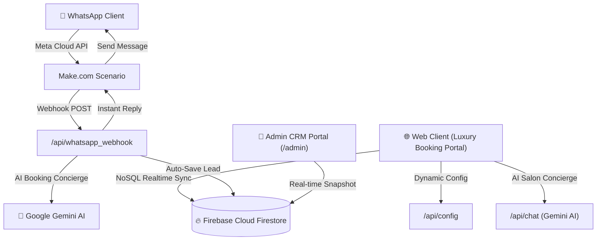

# 💇‍♀️ Chanu Salon | AI-Automated Booking & Real-Time Cloud CRM System

An enterprise-grade, omni-channel Salon Appointment Booking & Customer Relationship Management (CRM) platform built for modern beauty sanctuaries. Powered by **Google Gemini AI**, **Firebase Firestore NoSQL Database**, and **Meta WhatsApp Business Cloud API (via Make.com)**.

---

## 🌟 Key Architecture & Highlights



- **🎨 Ultra-Luxury Frontend:** Built with Vanilla HTML5, modern CSS custom properties, and Vanilla JS. Zero heavy frontend frameworks, sub-second initial load, glassmorphism aesthetics with Google Fonts (`Playfair Display` & `Plus Jakarta Sans`).
- **🧠 Gemini AI Beauty Concierge ("Anya"):** Real-time conversational agent specialized in salon styling, treatments, haircut rates, and schedule recommendations.
- **⚡ Omnichannel Cloud CRM Dashboard:** Live sync across website bookings and WhatsApp inquiries. Dynamic sound and pulse notifications on new leads, status management (`Confirmed`, `In-Progress`, `Completed`, `Cancelled`), and direct WhatsApp follow-up links.
- **🔐 Zero-Secret Architecture:** Absolutely no API keys hardcoded in frontend files. Client configs served dynamically via serverless endpoints from `.env` environment variables.
- **📱 Meta WhatsApp Business Cloud Integration:** Automated webhook processing via Make.com for instant customer service and CRM lead ingestion.

---

## 📂 Project Structure

```text
salon-ai-crm/
├── api/
│   ├── chat.py               # Gemini AI beauty concierge serverless endpoint
│   ├── config.py             # Secure Firebase client config provider
│   └── whatsapp_webhook.py   # WhatsApp automation webhook & CRM ingester
├── public/
│   ├── css/
│   │   ├── style.css         # Luxury client booking UI styling
│   │   └── admin.css         # Modern SaaS CRM dashboard styling
│   ├── js/
│   │   ├── firebase-init.js  # Dynamic Firebase client SDK loader
│   │   ├── booking.js        # 30-min slot collision checker & receipt calculator
│   │   ├── chatbot.js        # Floating AI widget client logic
│   │   └── admin-crm.js      # Passcode-protected live CRM sync & metrics
│   ├── index.html            # Public salon booking sanctuary landing page
│   └── admin.html            # Real-time Cloud CRM portal
├── dev_server.py             # Local development server (port 5000)
├── requirements.txt          # Python dependencies for Vercel Serverless
├── vercel.json               # Vercel deployment routing & rewrites
├── .env.example              # Sample environment variable template
└── .gitignore                # Protects secrets & runtime files
```

---

## 🚀 Getting Started

### 1. Clone & Configure Environment

```bash
git clone https://github.com/Kavishka-Pramodya/AI-Automated-Salon-Booking-System.git
cd AI-Automated-Salon-Booking-System
```

Create a `.env` file from `.env.example`:

```ini
GEMINI_API_KEY=your_gemini_api_key_here
FIREBASE_API_KEY=your_firebase_api_key
FIREBASE_AUTH_DOMAIN=your_project.firebaseapp.com
FIREBASE_PROJECT_ID=your_firebase_project_id
FIREBASE_STORAGE_BUCKET=your_project.firebasestorage.app
FIREBASE_MESSAGING_SENDER_ID=your_sender_id
FIREBASE_APP_ID=your_app_id
FIREBASE_MEASUREMENT_ID=your_measurement_id
ADMIN_PASSCODE=chanu2025
```

### 2. Run Locally

```bash
python -m venv venv
source venv/bin/activate  # Or `venv\Scripts\activate` on Windows
pip install -r requirements.txt
python dev_server.py
```

- Public Booking Interface: `http://localhost:5000/`
- Admin CRM Dashboard: `http://localhost:5000/admin` (Passcode: `chanu2025`)

---

## ☁️ Deploying to Vercel

1. Push this repository to GitHub.
2. Import the repository in [Vercel](https://vercel.com).
3. Set the Environment Variables listed in `.env.example` in Vercel Project Settings.
4. Deploy! Your salon booking sanctuary and serverless endpoints are live in seconds.

---

## 📄 License
MIT License. Built by Kavishka Pramodya.
